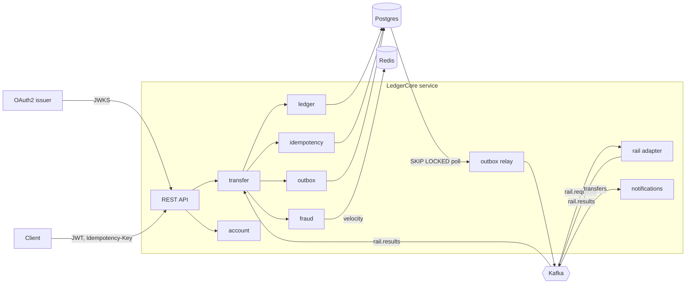

# LedgerCore

A small banking core: accounts, internal transfers, payouts to an external rail, and fraud checks, all
sitting on a double-entry ledger in Postgres. It is a single Spring Boot service split into modules, with
Kafka for the asynchronous parts and Redis for velocity counters.

I built it to work through the problems that make payment systems hard in practice: retries that must
not move money twice, parallel transfers on the same account, a payout that is half done when the
process dies, and a ledger you can prove nobody edited.

## What it does

- Accounts (savings, current, wallet) in minor units with an ISO currency. INR only by default.
- Internal transfers posted as one balanced journal entry in one database transaction.
- External payouts as a saga: hold the funds, send the request to a mock IMPS-style rail over Kafka,
  then capture or release the hold when the result comes back.
- Deposits and reversals for ops users.
- Fraud scoring on every transfer with stored reason codes. High scores are blocked; medium scores
  hold the funds and wait for an ops user to approve or reject (maker-checker: the approver can't be the
  person who initiated the transfer).
- Transaction history with keyset pagination.
- Per-account SHA-256 hash chain over postings and an endpoint that verifies it.
- Append-only audit trail of every state change, with the trace id of the request that caused it.
- Notifications on debit, credit, failure and reversal, written by a Kafka consumer.

## Architecture



Each module under `com.ledgercore` has `domain` (plain Java, no Spring), `application` (use cases and the
ports they need) and `adapter` (web, persistence, messaging, scheduling). `ArchitectureTest` enforces the
direction of those dependencies, so a controller can't reach for a JDBC template and the domain can't pick
up a framework annotation.

### A transfer, step by step

1. The JWT is validated and the caller is resolved to an `Actor`. Ownership is checked on every account
   the request names; someone else's account looks the same as one that doesn't exist (404).
2. In one Postgres transaction:
   - the idempotency key is claimed with `INSERT ... ON CONFLICT`, scoped to the caller;
   - fraud rules run and the decision is stored;
   - balance rows are locked with `SELECT ... FOR UPDATE` in ascending account id order;
   - a journal entry with balanced postings is written (or a hold, for payouts and reviews);
   - the transfer, audit event, outbox event and the response for the idempotency record are written.
3. After commit the outbox relay publishes the event to Kafka.

A retry with the same key and body gets the stored response back with `Idempotent-Replayed: true`. The
same key with a different body is a 422. A retry that arrives while the first request is still running
gets a 409.

### What keeps the money right

The application checks balances, but the database has the last word:

- A deferrable constraint trigger rejects any journal entry whose postings don't sum to zero at commit.
- `journal_entry`, `posting` and `audit_event` reject `UPDATE`, `DELETE` and `TRUNCATE`.
- `account_balance` has `CHECK (allow_negative OR balance_minor - held_minor >= 0)`; only system accounts
  (cash clearing, rail settlement) may go negative.
- Each posting stores the hash of the previous posting on the same account. `GET /v1/accounts/{id}/integrity`
  walks the chain and reports the first posting that doesn't match.
- `lock_timeout` (2s) and `statement_timeout` (10s) are set on every connection. A lock timeout comes
  back as 503 with `Retry-After`, which is safe to retry because of the idempotency key.

### Where the data structures are

- `fraud/domain/BloomFilter`: a bit-array Bloom filter with double hashing in front of the denylist
  table, so the common case (device not on the list) never touches the database.
- Velocity uses a Redis sorted set per source account as a sliding window, updated by a Lua script so
  the trim, add and count happen atomically.
- `ledger/domain/ChainVerifier`: a linear walk over the hash chain.
- Keyset pagination on the posting id (monotonic per account) with an opaque, versioned cursor.
- Sorted lock acquisition across accounts to avoid deadlocks between opposite transfers.

### Errors

Every error is RFC 7807 `application/problem+json` with a stable `code`, e.g.

```json
{"type":"urn:ledgercore:problem:idempotency-key-reused","title":"Unprocessable Entity","status":422,
 "detail":"Idempotency-Key was already used with a different request body","code":"idempotency-key-reused"}
```

## Running it

You need Docker with Compose. The stack binds to localhost only, on ports 7690 (API), 7691 (mock OAuth2
issuer), 55490 (Postgres) and 6440 (Redis).

```sh
docker compose up -d --build --wait
./scripts/demo.sh        # walks through the flows below, needs curl and jq
./scripts/load.sh        # optional: N=2000 C=16 by default
docker compose down -v
```

The demo opens accounts for two customers, deposits money, sends a transfer and retries it with the same
key, tries to overspend and to spend from someone else's account, sends a high-value transfer to review
and approves it, makes one payout the rail accepts and one it rejects, reverses a transfer, pages through
history, checks the hash chain and the audit trail, and finally shows that all postings across all accounts
sum to zero.

Tokens come from [mock-oauth2-server](https://github.com/navikt/mock-oauth2-server) with four fixed
clients: `alice` and `bob` are customers, `ops-asha` and `ops-ravi` have the `ops` role.

```sh
TOKEN=$(curl -s -H 'Host: oauth:8080' -d grant_type=client_credentials -d client_id=alice \
  -d client_secret=unused http://localhost:7691/ledgercore/token | jq -r .access_token)
curl -s -H "Authorization: Bearer $TOKEN" http://localhost:7690/v1/accounts
```

The `Host` header is there because the issuer is taken from it, and the app expects the in-network name.

### API

| Method | Path | Who |
| --- | --- | --- |
| POST, GET | `/v1/accounts`, `/v1/accounts/{id}` | owner |
| GET | `/v1/accounts/{id}/balance` | owner |
| GET | `/v1/accounts/{id}/transactions?limit=&cursor=` | owner |
| POST | `/v1/transfers` (needs `Idempotency-Key`) | owner of the source account |
| GET | `/v1/transfers/{id}` | owner of either side; ops also see the fraud assessment |
| POST | `/v1/transfers/{id}/approve`, `/reject`, `/reverse` | ops |
| POST | `/v1/accounts/{id}/deposits` (needs `Idempotency-Key`) | ops |
| GET | `/v1/accounts/{id}/integrity`, `/v1/audit?resourceId=` | ops |
| POST | `/v1/fraud/denylist` | ops |

Reads need the `ledger.read` scope and writes `ledger.write`. Metrics are at `/actuator/prometheus`.

## Tests

```sh
mvn verify
```

Unit tests cover the domain types and fraud rules. `ArchitectureTest` checks module boundaries. The
integration tests run against real Postgres, Redis and Kafka in Testcontainers and cover:

- 50 transfers fired in parallel across 5 accounts: every one ends `POSTED` or `FAILED`, no balance goes
  negative, the total is unchanged, every hash chain verifies and no journal entry is unbalanced;
- idempotent replay, key reuse with a different body, keys scoped per caller, and 8 concurrent requests
  with one key producing exactly one transfer;
- the payout saga in both directions, including a duplicate rail result being ignored;
- review, approval, rejection and maker-checker;
- tamper detection after editing a posting with the trigger disabled, and the database refusing an
  unbalanced entry;
- access control: missing and forged tokens, read-only scope, other people's accounts, ops-only endpoints.

## Measured numbers

From `scripts/load.sh` with the defaults (2,000 internal transfers, 16 concurrent clients, 200 accounts):

```
requests=2000 concurrency=16 wall=4.9s throughput=407 req/s
latency ms: p50=19.5 p95=37.3 p99=49.7 max=71.8
HTTP 201: 2000
```

All 2,000 posted, the postings summed to zero and no account went negative afterwards. Take these as a
rough floor, not a benchmark: it was one run on a shared 8-vCPU Linux VM with about 3 GB of free memory,
with the app (384 MB heap), Postgres, Kafka, Redis and the curl-based client all on the same machine,
nothing tuned, and Postgres on default settings.

## Design decisions

- **Postgres is the source of truth for everything that matters.** Balances, holds, idempotency records,
  the outbox and the audit trail live in the same database as the journal, so one transaction covers all
  of them. Redis only holds velocity counters, which are fine to lose.
- **No balance cache.** The overdraft check has to read the locked row anyway, and the balance row can
  be rebuilt from postings.
- **Only payouts are sagas.** An internal transfer is one ACID transaction; there's nothing to compensate.
- **Outbox over dual writes.** Kafka being down slows notifications and payouts but never blocks or loses
  a committed transfer. Delivery is at-least-once and every consumer dedupes on the event id.
- **Locks over optimistic retries.** Contention on a hot account turns into short waits rather than a
  retry storm, and the sorted order rules out deadlocks between two accounts paying each other.
- **If Redis is down, fraud fails safe.** The velocity rule can't run, so the assessment is marked
  `degraded` and larger amounts go to review instead of being allowed.

## Differences from the original design

I sketched this with more scope than I built. Where I simplified:

- **Identity provider.** mock-oauth2-server instead of Keycloak. The app is a plain JWT resource server,
  so pointing it at Keycloak is a config change.
- **One fraud pass instead of two stages.** All four rules (denylist, velocity, high value, new payee)
  are cheap, so every transfer runs all of them. The Bloom filter still sits in front of the denylist.
- **Notifications are rows in a table**, not email, SMS or push.
- **Integrity checks run on demand** through the ops endpoint; there's no scheduled job yet.
- **Not built:** KYC onboarding, PDF/CSV statements, beneficiary management with a cooling period
  (first payments to a new payee get a higher fraud score instead), scheduled transfers, per-channel
  limits, hot-account sub-ledgers and the settlement file export.

## Known limitations

- Still on Spring Boot 3.5. Two spring-webmvc CVEs (CVE-2026-47884, CVE-2026-47890) are only fixed in
  Spring Framework 7, so `.trivyignore` lists them. Neither code path (XsltView, Server-Sent Events) is
  used here. Moving to Boot 4 removes the exception.
- Single currency in practice. Money carries its currency and cross-currency transfers are refused, but
  there is no FX.
- The mock rail always answers. A real rail can time out with the outcome unknown; the design is to keep
  the transfer `HELD` and resolve it with a status inquiry, which isn't implemented.
- Payout holds have no expiry; review holds are released after 24 hours by a scheduled job.
- Hot accounts serialise on their balance row. The system accounts used for deposits and payouts are the
  first place that will show.
- The outbox relay polls every 200 ms. Fine at this size; Debezium could replace it without changing the
  table.
- The integration tests use their own JWT decoder, so audience validation is only exercised by the
  compose stack.
- Velocity windows are per source account only, not per device or per customer.
